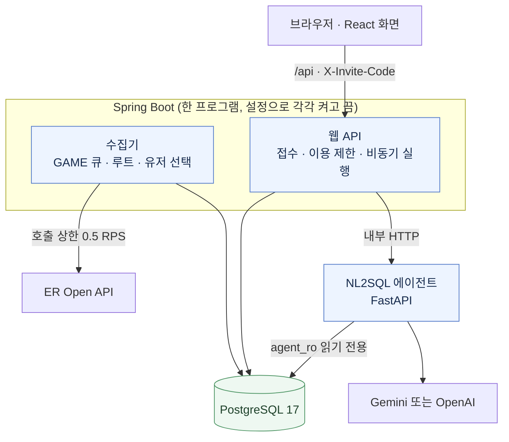

<a id="top"></a>

<div align="center">

<h1>📊 ER Analytics</h1>

<p><strong>SQL 없이 이터널 리턴 전적 데이터베이스를 직접 묻는 NL2SQL 분석 서비스</strong></p>
<p>경기 데이터 수집 · 한국어 질문 → SQL 변환 · 실행 결과와 근거 제공 · 메타 변화 파악</p>


</div>

<p align="center">
  <a href="#서비스-소개">💡 서비스 소개</a> ·
  <a href="#현재-상태">🚦 현재 상태</a> ·
  <a href="#주요-기능">✨ 주요 기능</a> ·
  <a href="#기술-스택">🛠️ 기술 스택</a> ·
  <a href="#시스템-구조">🏗️ 시스템 구조</a> ·
  <a href="#핵심-구현">⚙️ 핵심 구현</a> ·
  <a href="#로컬-실행">🚀 로컬 실행</a>
</p>

---

<a id="서비스-소개"></a>

## 💡 서비스 소개

**ER Analytics는 이터널 리턴 경기 데이터를 모아 두고, 한국어로 던진 질문을 SQL로 바꿔 데이터베이스 결과를 그대로 보여 주는 비영리 학술 프로젝트입니다.**
"요즘 이 캐릭터 승률이 어때?", "패치 뒤에 어떤 아이템 빌드가 늘었어?" 같은 질문을 SQL을 몰라도 물을 수 있고, 답변에는 실행한 SQL과 근거 데이터가 함께 나옵니다.

개인 전적 검색이나 단순 통계표와 경쟁하지 않습니다. 이 프로젝트의 가치는 **수집해 둔 전적 전체를 직접 조회해 보는 경험**과 **패치에 따른 메타 변화를 데이터로 파악하는 것**에 있습니다.

지인에게 먼저 열어 후기를 받는 MVP-1을 만들고 있으며, 이 저장소에는 수집기, 웹 API, NL2SQL 에이전트, 화면, DB 마이그레이션이 모두 들어 있습니다.

| 📥 01. 수집 | 💬 02. 질문 | 🧠 03. 변환·검증 | 📋 04. 결과·근거 |
| :--- | :--- | :--- | :--- |
| ER Open API에서 경기·참가자·루트를 호출 상한 안에서 저장 | 초대 코드로 접속해 조건을 고르고 한국어로 질문 | 지표·이름·조건을 검증한 뒤 SQL을 만들고 가드로 검사 | 읽기 전용 계정으로 실행한 결과와 SQL, 되묻기·안내 표시 |

<a id="현재-상태"></a>

## 🚦 현재 상태

> 2026-10-30 기준입니다. 구현과 로컬 검증이 끝난 것과 운영 서버에 적용된 것을 구분해서 적었습니다.

| 구성 | 상태 |
| :--- | :--- |
| 🗃️ 수집기·DB | **운영 중** — EC2에서 시즌 41 랭크 스쿼드 경기를 호출 상한(0.5 RPS)에 가깝게 수집 |
| 🌐 웹 API·NL2SQL 에이전트·화면 | **구현과 로컬 검증 완료, 운영 서버 적용 진행 중** — 서버 안에서는 기동을 확인했지만 외부 접속과 질문 왕복 검증이 남음 |
| 👥 지인 공개 | 최종보고서 제출(2026-10-30) 이후, 날짜 미정 |

- 수집 규모 예시(2026-10-28 23:44): 경기 약 26.6만 건, DB 약 47.5GB, 하루 약 4.25GB 증가
- 접속은 도메인 없이 서버 IP의 HTTP이고, 로그인 없이 **초대 코드**(`X-Invite-Code` 헤더)로 접근을 제한합니다.
- 공개 전에 고칠 것과 결정할 것은 [docs/spec.md](docs/spec.md)의 '발견사항과 기획 영향'과 '미결정'에 정리해 두었습니다.

<a id="주요-기능"></a>

## ✨ 주요 기능

| 영역 | 기능 | 설명 |
| :--- | :--- | :--- |
| 📥 **데이터 수집** | 경기·참가자·루트 수집 | 처리 대기열, 경기 뒤 루트 조회, 티어별 유저 선택, 경기 목록 순회를 반복하는 단일 워커 |
| 💬 **한국어 질문** | 조건 선택 + 자연어 질문 | 초대 코드로 접속, 조건을 고른 뒤 질문하고 답변·안내·되묻기를 확인 |
| 🧠 **NL2SQL** | 질문 → 검증 → SQL → 실행 | 모델이 만든 SQL을 가드로 검사하고 읽기 전용 계정에서만 실행 |
| 📋 **근거 제공** | SQL·결과 표시 | 실행한 SQL과 결과 행을 함께 보여 줘 답을 직접 확인 가능 |
| 🛡️ **이용 제한** | 초대 코드, 하루 질문 수 제한 | 바쁠 때는 접수 전에 거절하고 남은 횟수를 응답에 담음 |
| ⭐ **후기 수집** | 답변 후기 | 공개 후 평가에 쓸 이용자 후기 저장 |
| 📈 **수집 현황** | 이용자용 현황 화면 | 얼마나, 어디까지 수집했는지 이용자에게 안내 |
| 🔀 **모델 선택** | Gemini 또는 OpenAI | 배포마다 `LLM_PROVIDER`로 선택 |

<details>
<summary><strong>🔒 질문 실행 안전장치 보기</strong></summary>

| 장치 | 내용 |
| :--- | :--- |
| 읽기 전용 계정 | 생성 SQL은 `agent_ro` 계정에서만 실행 |
| 단일 SELECT | SELECT 한 문장만 허용, 나머지는 거부 |
| 허용 목록 | 허용한 테이블·뷰만 조회 가능 |
| 시간·행 제한 | SQL 실행 시간 20초, 결과 행 수 제한 |
| 개인정보 | 모델에 전달하는 샘플 닉네임 마스킹, 전달 데이터 최소화 |
| 단일 질문 처리 | 에이전트는 한 번에 한 질문만 처리하고 동시 요청은 503 |

가드 규칙은 허용·거부 사례로 검증합니다. 생성 SQL의 **실행 성공**과 **질문 의도에 맞는 정확도**는 구분해서 평가합니다.

</details>

<a id="기술-스택"></a>

## 🛠️ 기술 스택

| 구분 | 사용 기술 |
| :--- | :--- |
| ☕ **Backend** |    |
| 🗃️ **Persistence** |    |
| 💾 **Database** |  |
| 🤖 **NL2SQL Agent** |     |
| 🧠 **LLM** |   |
| 🖥️ **Frontend** |    |
| ☁️ **Infrastructure** |   |
| 🧪 **Test & Quality** |      |

<details>
<summary><strong>📋 기술별 버전과 사용 목적 자세히 보기</strong></summary>

버전은 저장소의 `build.gradle`, `pyproject.toml`, `package.json`을 기준으로 작성했습니다.

| 구분 | 기술 | 용도 |
| :--- | :--- | :--- |
| 언어·빌드 | Java 21, Gradle Wrapper | 수집기와 웹 API 빌드·테스트 |
| 프레임워크 | Spring Boot 3.5 (web, validation, JDBC, JPA) | 수집기와 웹 API를 한 프로그램으로 구성 |
| 마이그레이션 | Flyway (V1~V11) | 스키마·권한 변경 이력 관리 |
| 데이터베이스 | PostgreSQL 17 | 경기·참가자·루트·질문 기록 저장, 읽기 전용 계정으로 NL2SQL 조회 |
| 에이전트 | Python 3.12+, FastAPI, uvicorn, sqlglot, psycopg 3 | 내부 HTTP 서버, SQL 구문 분석·가드, DB 조회 |
| LLM | google-genai, openai | `LLM_PROVIDER`로 Gemini·OpenAI 중 선택 |
| 화면 | React 19, TypeScript, Vite | 질문 화면, 정적 빌드를 Spring이 `/`에서 제공 |
| 코드 검사 | Spotless, Checkstyle, Ruff, ESLint | 스타일·구조 규칙 검사 (패키지 간 import 규칙 포함) |
| 테스트 | JUnit, pytest, Vitest | 단위·통합 테스트, 가짜 응답 기반 화면 테스트 |
| 배포 | Docker Compose, AWS EC2 | 릴리스 폴더와 override 파일 방식으로 서비스별 적용 |

</details>

<a id="시스템-구조"></a>

## 🏗️ 시스템 구조



수집기와 웹 API는 한 프로그램(`backend/pipeline`) 안의 서로 다른 패키지입니다. 서로의 코드를 가져다 쓰지 않으며 Checkstyle의 import 규칙이 이를 검사합니다. 파트 사이에는 코드 대신 [계약 문서](docs/contracts)로 형식을 맞춥니다.

| 파트 | 위치 | 담당 역할 |
| :--- | :--- | :--- |
| 수집기 (pipeline) | `backend/pipeline/` | ER Open API 호출, 저장, 수집 순서 관리 |
| 웹 API (api-server) | `backend/pipeline/` | 초대 코드·이용 제한, 질문 접수, 에이전트 호출, 결과 전달 |
| 에이전트 (agent) | `agent_server/` | 질문 해석, SQL 생성·검증, 읽기 전용 실행 |
| 화면 (frontend) | `frontend/` | 질문 화면, 답변·안내·되묻기, 후기, 수집 현황 |
| 데이터베이스 | `db/migrations/`, `db/init/` | Flyway 마이그레이션, 계정 초기화 |

<a id="핵심-구현"></a>

## ⚙️ 핵심 구현

### 🔄 NL2SQL 질문 처리

1. **접수** — 웹 API가 초대 코드와 하루 질문 수를 확인하고, 바쁘면 접수 전에 거절합니다(응답에 남은 횟수 포함).
2. **요청 식별** — 요청 ID는 UUIDv4로 만들고 초대 코드에 묶어, 다른 사람의 결과를 조회하지 못하게 합니다.
3. **변환** — 에이전트가 지표·이름·조건을 검증하고 `schema_context.md`(DB 설명)와 `metrics.md`(지표 정의)를 바탕으로 SQL을 만듭니다.
4. **가드와 실행** — 단일 SELECT, 허용 테이블, 시간·행 제한을 검사한 뒤 `agent_ro` 계정으로 실행합니다.
5. **응답** — 화면은 2초마다 결과를 확인(요청당 10초, 전체 420초 제한)하고 답변·SQL·근거를 보여 줍니다.

| 설계 항목 | 적용 방식 |
| :--- | :--- |
| 과부하 대응 | 작업 대기열이 차면 접수하지 않고 거절, 에이전트는 동시 요청에 503 |
| 안전한 실행 | 읽기 전용 계정, 단일 SELECT, 허용 목록, 실행 시간·행 수 제한 |
| 멱등 수집 | PK/UNIQUE와 upsert로 같은 데이터를 다시 받아도 중복 저장하지 않음 |
| 호출 속도 제한 | 비영리 API 정책에 맞춰 호출 속도와 재시도를 제한하고, HTTP와 응답 내부 code를 함께 해석 |
| 스키마 변경 | 적용된 마이그레이션은 수정하지 않고 새 버전으로 추가, 운영 적용 전 백업·점검 |
| 모델 교체 | 에이전트가 공급자 차이를 흡수해 배포마다 Gemini·OpenAI 선택 |

### ⚡ 수집 지연 진단과 개선

운영에서 수집 속도가 예상보다 낮은 문제를 DB 실행 계획 측정으로 추적했습니다.

- **원인**: 유저 선택 쿼리가 매 주기마다 최신 패치 참가자를 티어별로 세면서 약 10GB 규모의 테이블 전체를 읽었습니다.
- **개선**: 티어별 집계를 1시간 동안 캐시하고(갱신 실패 시 이전 값 유지), 집계를 '최신 패치의 경기 번호를 먼저 뽑는' 형태로 바꿨습니다.
- **결과**: 읽기량이 약 9.6GiB에서 약 78MiB로 줄었고(약 126배), 수집 호출률은 시간당 약 447건에서 약 1,737건으로 늘었습니다(약 3.9배).
- 큰 테이블의 autovacuum·analyze 기준도 낮춰 통계가 오래되지 않게 했습니다.

실행 계획 표와 판단 근거는 `docs/archive/db_io_diagnosis_2026-10-27.md`에 보관되어 있습니다.

<a id="로컬-실행"></a>

## 🚀 로컬 실행

### 1. 준비

Java 21, Docker, Python 3.12 이상, [uv](https://docs.astral.sh/uv/), Node.js(화면)가 필요합니다. `.env`가 없다면 `.env.example`을 복사해 실제 환경값을 채웁니다. 비밀값은 Git에 넣지 않습니다.

### 2. DB 실행과 마이그레이션 (저장소 루트)

```powershell
docker compose up -d postgres
docker compose --profile migrate build migrate
docker compose --profile migrate run --rm migrate info
```

새 빈 DB는 `docker compose --profile migrate run --rm migrate`로 초기화합니다. 기존 볼륨은 현재 버전을 확인하고 [DB 변경 절차](docs/operations.md#db-변경과-배포)에 따라 명시적으로 처리하며, 자동 baseline은 쓰지 않습니다. PostgreSQL 최초 기동(initdb)은 계정만 만들고 테이블은 Flyway가 만듭니다.

> ⚠️ 운영 데이터 보존을 위해 `docker compose down -v`는 실행하지 않습니다. 실험은 별도 DB·볼륨에서 합니다.

### 3. 수집기·웹 API (`backend/pipeline`)

```powershell
.\gradlew.bat test
.\gradlew.bat bootRun --args="--er.collection.enabled=true --er.collection.continuous=false"
```

수집기는 시작할 때 마이그레이션을 실행하지 않고, 최신 마이그레이션(현재 V11)이 적용된 DB에서만 JPA 스키마 검증을 통과합니다. `continuous=false`는 처리 대기열과 조회할 사용자가 모두 없을 때 종료합니다. 빈 DB는 랭킹 목록 전체로 첫 시드를 만들기 때문에 이 실행은 소량 검증용 제한이 아닙니다. 소량 실제 API 검증은 격리된 DB와 검증 도구를 사용하세요([operations](docs/operations.md)).

웹 API는 `er.web-api.enabled` 설정으로 켜고 끕니다.

### 4. 에이전트 (`agent_server`)

```powershell
uv sync
uv run pytest
uv run er-agent manual game-count
uv run er-agent ask "수집된 경기는 몇 판이야?"
```

`ask`는 설정한 모델(Gemini 또는 OpenAI)의 호출 비용을 씁니다. `LLM_PROVIDER`와 해당 API 키를 `.env`에 설정하세요.

### 5. 화면 (`frontend`)

```powershell
npm ci
npm run dev      # 가짜 응답으로 개발
npm test
npm run build    # 실제 /api 호출 기본, 결과는 frontend/dist
```

개발 서버와 테스트는 가짜 응답을 사용하고, 빌드 결과는 Spring이 `/`에서 제공합니다. 환경 변수는 [frontend/AGENTS.md](frontend/AGENTS.md)를 참고하세요.

### 🔍 커밋 전 검사

| 파트 | 명령 |
| :--- | :--- |
| Python | `uv run ruff check . ../tools`, `uv run ruff format --check . ../tools` (`agent_server/`에서) |
| Java | `.\gradlew.bat check` (`backend/pipeline/`에서, Spotless·Checkstyle 포함) |
| 화면 | `npm run lint` (`frontend/`에서) |

자동 수정과 에디터 설정은 [operations](docs/operations.md)의 코드 스타일 검사 절을 따릅니다.

<a id="저장소-구조"></a>

## 📂 저장소 구조

```text
ER_NL2SQL/
├── backend/pipeline/     수집기 + 웹 API (Java 21, Spring Boot)
├── agent_server/         NL2SQL 에이전트 (Python, FastAPI)
│   └── evaluations/      시범 평가 도구
├── frontend/             질문 화면 (React, Vite, TypeScript)
├── db/
│   ├── migrations/       Flyway 마이그레이션 V1~V11, 런타임 권한 SQL
│   └── init/             계정 초기화
├── infra/                EC2 설치 보조 파일
├── tools/                운영 복사본 준비·분석 계정 검증 도구
├── docs/                 로컬 문서 (Git 제외)
├── compose.yaml          postgres · collector · migrate · agent
├── CLAUDE.md / AGENTS.md 개발 규칙
└── README.md
```

## 📚 문서 안내

`docs/`는 Git에서 제외된 로컬 문서입니다. 같은 사실을 여러 문서에 복사하지 않고 주인 문서에 둡니다.

| 문서 | 역할 |
| :--- | :--- |
| [CLAUDE.md](CLAUDE.md), [AGENTS.md](AGENTS.md) | 개발 규칙과 검증·문서 갱신 책임 |
| [docs/spec.md](docs/spec.md) | 목적, 일정, 파트별 현황, 결정(D)·발견사항(F)·미결정(Q), 요구사항 목록 |
| [docs/parts/](docs/parts) | 파트별 현황: [pipeline](docs/parts/pipeline.md), [agent](docs/parts/agent.md), [api-server](docs/parts/api-server.md), [frontend](docs/parts/frontend.md) |
| [docs/contracts/](docs/contracts) | 파트 사이의 형식: [database](docs/contracts/database.md), [agent-http](docs/contracts/agent-http.md), [web-api](docs/contracts/web-api.md) |
| [docs/operations.md](docs/operations.md) | 환경 설정, 실행, 배포, 백업, 마이그레이션, 운영 기록 |
| [docs/api_findings.md](docs/api_findings.md) | ER Open API 실측 사실과 미확인 사항 |
| [docs/archive](docs/archive) | 끝난 단계와 옛 기록 (현재 요구사항 아님) |

<a id="비영리-프로젝트"></a>

## 📝 프로젝트 성격

비영리 학술 프로젝트이며 ER Open API 이용 정책을 지킵니다. 개인 식별 정보 공개를 피하고, 모델에 전달하는 데이터는 최소화하며 샘플 닉네임은 마스킹합니다. 실제 수집은 ER API 호출과 DB 쓰기를 하므로 격리된 환경에서 먼저 확인하세요.

---

<p align="center"><a href="#top">⬆️ 맨 위로</a></p>
